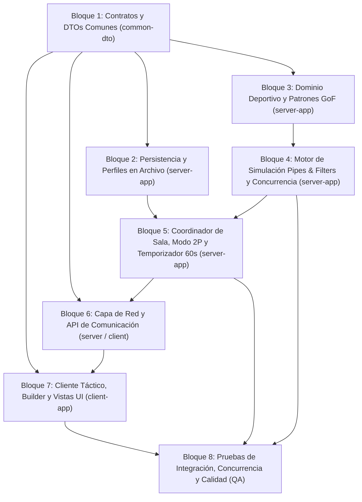

# Plan y Bloques de Desarrollo: Simulador Táctico "Soccer Manager"

Este documento desglosa de manera estructurada los **bloques de desarrollo** necesarios para construir el sistema completo. Cada bloque define su objetivo, componentes clave, tecnologías, patrones de diseño asociados, dependencias y criterios de completitud (*Definition of Done*).

---

## 1. Mapa General de Bloques de Desarrollo

---

## 2. Detalle de los Bloques de Desarrollo

### Bloque 1: Contratos y DTOs Compartidos (`common-dto`)
* **Propósito:** Crear la librería base compartida entre el Servidor y el Cliente con los modelos de transferencia de datos y enumeraciones del negocio, evitando dependencias circulares.
* **Componentes a desarrollar:**
  * `SesionDTO.java`: Datos de sesión autenticada (token/id, clubId, nombreManager).
  * `PerfilDTO.java`: Datos de perfil, estadísticas acumuladas y fecha de conexión.
  * `JugadorDTO.java`: Atributos base (Velocidad, Pase, Tiro, Defensa, Físico), energía y estado.
  * `PlanDeJuegoDTO.java`: Formación, lista de IDs de los 11 titulares y estrategia seleccionada.
  * `ReporteRivalDTO.java`: Historial de últimos 5 partidos, estilo de juego, formación habitual y jugador peligroso.
  * `ResultadoPartidoDTO.java`: Marcador final, club local, club visitante, lista de incidencias y calificaciones.
  * `IncidenciaDTO.java`: Minuto, tipo de evento (GOL, AMARILLA, ROJA, LESION), jugador involucrado y asistente.
  * `SalaEstadoDTO.java`: Modo activo (`SOLO` o `DOS_JUGADORES`), DTs conectados, estado de preparación (`ESPERANDO`, `EN_PLANIFICACION`, `CUENTA_REGRESIVA`, `SIMULANDO`) y `segundosRestantes` (0 a 60).
  * **Enums:** `FormacionEnum`, `EstrategiaEnum`, `EstadoJugadorEnum`, `ModoJuegoEnum`, `TipoIncidenciaEnum`.
* **Criterio de Entrega:** Módulo compilable de forma independiente que se serializa y deserializa a JSON sin pérdidas.

---

### Bloque 2: Persistencia y Gestión de Perfiles en Archivo (`server-app/persistence`)
* **Propósito:** Proveer un sistema de almacenamiento local basado en archivos individuales JSON por mánager en `data/perfiles/<usuario>.json`.
* **Componentes a desarrollar:**
  * `PerfilUsuario.java`: Entidad de perfil con credenciales hasheadas (BCrypt o SHA-256), club asignado y récord (victorias, empates, derrotas).
  * `PerfilArchivoRepository.java`: 
    * Método `existePerfil(String usuario)`: Inspecciona el directorio de datos.
    * Método `crearPerfilAutomatico(String usuario, String pass)`: Genera el archivo físico con valores iniciales cuando el usuario no existe.
    * Método `cargarPerfil(String usuario)`: Parsea el archivo JSON a objeto en memoria.
    * Método `actualizarEstadisticas(String usuario, ResultadoPartidoDTO resultado)`: Sobrescribe el archivo de forma atómica.
  * **Concurrencia y Bloqueos:** Implementar `ReentrantReadWriteLock` por archivo para evitar corrupciones de datos si ocurren lecturas y escrituras simultáneas.
* **Criterio de Entrega:** Registro y login automáticos verificados en disco; creación física del archivo `.json` comprobada.

---

### Bloque 3: Modelo de Dominio Deportivo y Patrones GoF (`server-app/domain`)
* **Propósito:** Modelar la lógica pura del fútbol, las jerarquías de equipo y las variaciones de comportamiento.
* **Componentes y Patrones:**
  1. **Patrón Composite (`model`):**
     * Interfaz `ComponenteTactico`: Métodos `calcularPoderOfensivo()` y `calcularPoderDefensivo()`.
     * `Jugador` (Hoja): Calcula aportes individuales en base a sus estadísticas.
     * `LineaTactica` (Compuesto): Agrupa futbolistas por línea (Defensa, Mediocampo, Delantera) y calcula medias ponderadas.
     * `Equipo` (Compuesto Raíz): Consolida las líneas para el cálculo global.
  2. **Patrón Strategy (`strategy`):**
     * Interfaz `EstrategiaTactica`: Métodos `aplicarModificadores(Equipo miEquipo, Equipo rival)` y `calcularDesgaste()`.
     * Clases concretas: `PosesionStrategy`, `ContraataqueStrategy`, `PresionAltaStrategy`, `BloqueBajoStrategy`.
     * Matriz de contrarrestos (ej. Contraataque con bono frente a Posesión, Presión Alta con mayor tasa de recuperación pero más desgaste físico).
  3. **Patrón State (`state`):**
     * Interfaz `EstadoJugador`: Métodos `puedeJugar()`, `obtenerFactorRendimiento()` y `avanzarJornada()`.
     * Clases concretas: `EstadoOptimo` (100% rendimiento), `EstadoCansado` (penalización física), `EstadoLesionado` (inhabilitado con contador de fechas), `EstadoSancionado` (inhabilitado por tarjetas).
* **Criterio de Entrega:** Pruebas unitarias que validen los cálculos del Composite, las ventajas tácticas de las estrategias y las transiciones del ciclo de vida del jugador.

---

### Bloque 4: Motor de Simulación, Pipes & Filters y Concurrencia (`server-app/engine`)
* **Propósito:** Computar los partidos de forma paralela y modular.
* **Componentes a desarrollar:**
  * **Patrón Pipes and Filters:**
    * `ContextoPartido.java`: Objeto que viaja a través de la tubería.
    * `FiltroValidacion.java`: Valida 11 jugadores habilitados; auto-completa con IA si faltan datos.
    * `FiltroCalculoTactico.java`: Aplica el Composite y cruce de Strategies para obtener coeficientes de gol.
    * `FiltroSimulacionEventos.java`: Algoritmo minuto a minuto (1 al 90) que genera goles, faltas, tarjetas y notas.
    * `FiltroDesgaste.java`: Ajusta nivel de energía y calcula probabilidad estocástica de lesiones.
    * `FiltroConsolidacion.java`: Empaqueta el resultado final.
  * **Simulador Concurrente de Jornada:**
    * `TareaPartido.java`: Implementa `Callable<ResultadoPartidoDTO>`.
    * `SimuladorJornada.java`: Administra un `ExecutorService` de tamaño fijo (`newFixedThreadPool`).
    * Sincronización de barrera mediante `CompletableFuture.allOf` o `invokeAll`.
    * `TablaPosicionesService.java`: Actualización de la clasificación protegida mediante `ReentrantLock`.
* **Criterio de Entrega:** Simulación paralela de 10 partidos simultáneos en menos de 1 segundo sin errores de concurrencia ni inconsistencias en la tabla.

---

### Bloque 5: Coordinador de Modos, Sala 2 Jugadores y Temporizador de 60s (`server-app/lobby`)
* **Propósito:** Coordinar la interacción entre los mánagers, la edición en paralelo de tácticas y el mecanismo de cuenta regresiva competitiva.
* **Componentes a desarrollar:**
  * `GestorModoYSala.java`: Mantiene el ciclo de vida de la partida (`SOLO` o `DOS_JUGADORES`).
  * `TemporizadorJornada.java`: Utiliza `ScheduledExecutorService` para la cuenta regresiva de 60 segundos:
    * Inicia cuando el **primer jugador** confirma su estrategia y presiona "Simular".
    * Emite un pulso cada segundo decrementando el contador (60, 59, 58...).
    * Si el **segundo jugador confirma antes de los 60s**, cancela el temporizador y lanza la simulación inmediatamente.
    * Si el **contador llega a 0s (timeout)**, captura automáticamente la alineación tal como la tenga el segundo jugador (ejecutando auto-completado por IA si no alcanzó a colocar los 11 titulares) y dispara la simulación forzada.
  * `ScoutingFacade.java` (Patrón **Facade**): Agrupa la información del próximo rival para el cliente.
* **Criterio de Entrega:** Temporizador preciso de 60s comprobado con cancelación anticipada por envío oportuno o disparo automático por expiración de tiempo.

---

### Bloque 6: Capa de Red y API de Comunicación (`server-app/api` & `client-app/network`)
* **Propósito:** Exponer los servicios del backend e implementar el cliente de red en el frontend.
* **Componentes a desarrollar:**
  * **Controladores en Servidor (REST o Sockets TCP):**
    * `POST /api/sesion/login-o-registro`: Autenticación con auto-creación de archivo.
    * `POST /api/partida/modo`: Configuración de modo (Solo o 2 Jugadores).
    * `GET /api/partida/sala-estado`: Consulta del estado de la sala y segundos restantes del contador.
    * `GET /api/club/{id}/plantilla`: Nómina con atributos y estados.
    * `GET /api/scouting/{rivalId}`: Consulta al Facade de scouting.
    * `POST /api/jornada/plan-juego`: Recepción de la táctica del jugador.
    * `POST /api/jornada/simular`: Solicitud de simulación (inicia el temporizador de 60s en modo 2P o simula de inmediato en 1P).
    * `GET /api/torneo/tabla-y-resultados`: Marcadores e incidencias de la jornada.
  * **Capa de Red en Cliente (`MotorConexion`):**
    * Manejo de peticiones HTTP/JSON (o sockets persistentes) con sondeo/polling o callbacks para refrescar el temporizador en pantalla.
* **Criterio de Entrega:** Endpoints testeados mediante colecciones de prueba con respuestas JSON válidas.

---

### Bloque 7: Cliente Táctico, Builder y Vistas de Usuario (`client-app/ui` & `builders`)
* **Propósito:** Interfaz gráfica interactiva y validaciones ergonómicas en el cliente.
* **Componentes a desarrollar:**
  * **Patrón Builder (`PlanDeJuegoBuilder.java`):**
    * Métodos encadenados (`setFormacion`, `agregarTitular`, `setEstrategia`).
    * Validación local en tiempo real: verificar 11 jugadores, unicidad, posiciones cubiertas y bloqueo de jugadores lesionados o sancionados.
  * **Vistas de Interfaz (MVP):**
    1. `VistaLogin`: Entrada de usuario/clave con retroalimentación de nuevo archivo de perfil creado.
    2. `VistaSelectorModo`: Selección de *Solo vs IA* o *2 Jugadores*, y pantalla de sala de espera.
    3. `VistaMiPlantilla`: Tabla con barras de energía, semáforos de estado (*State*) y estadísticas.
    4. `VistaCentroScouting`: Comparativa de medias por línea y jugador estrella rival.
    5. `VistaPizarraTactica`: Alineación interactiva, botón de "Simular Jornada" y **componente visual de cuenta regresiva de 60 segundos** con alerta sonora/visual cuando el otro jugador ya confirmó.
    6. `VistaPanelResultados`: Marcadores de la fecha, resumen de incidencias, goleadores y tabla general.
* **Criterio de Entrega:** Flujo completo navegable en el cliente, permitiendo jugar una temporada completa de inicio a fin.

---

### Bloque 8: Pruebas de Integración, Concurrencia y Calidad (QA)
* **Propósito:** Validar el sistema integral bajo condiciones de concurrencia y estrés.
* **Batería de Pruebas:**
  * **Pruebas de Concurrencia:** Verificación de cero condiciones de carrera con 10 partidos simultáneos actualizando la tabla con `ReentrantLock`.
  * **Pruebas de Temporizador 60s:**
    * Caso A: El segundo jugador envía a los 25 segundos -> Simulación inmediata.
    * Caso B: El segundo jugador no envía -> A los 60s se simula automáticamente con su alineación actual.
  * **Pruebas de Persistencia:** Verificación de creación física de archivos `.json`, validación de contraseñas y consistencia de estadísticas tras 5 jornadas simuladas.
  * **Pruebas de Patrones:** Validaciones unitarias del Builder, Composite, Strategy, State y Facade.
* **Criterio de Entrega:** Suite de tests automatizados aprobada al 100%.

---

## 3. Matriz de Dependencias y Ruta Crítica de Desarrollo

| Secuencia | Bloque | Dependencias Previas | Entregable Clave |
| :---: | :--- | :--- | :--- |
| **Paso 1** | **Bloque 1: common-dto** | Ninguna | JAR de DTOs y contratos compartidos |
| **Paso 2** | **Bloque 2: Persistencia Perfiles** | Bloque 1 | Repositorio de archivos JSON en `data/perfiles/` |
| **Paso 3** | **Bloque 3: Dominio Deportivo** | Bloque 1 | Composite, Strategy y State implementados |
| **Paso 4** | **Bloque 4: Motor de Simulación** | Bloque 1, Bloque 3 | Pipeline de 5 filtros y ThreadPool concurrente |
| **Paso 5** | **Bloque 5: Sala y Timer 60s** | Bloque 2, Bloque 4 | Coordinador 1P/2P con temporizador de 60s |
| **Paso 6** | **Bloque 6: API y Red** | Bloque 1, Bloque 5 | Endpoints REST / Sockets operativos |
| **Paso 7** | **Bloque 7: Cliente y UI** | Bloque 1, Bloque 6 | App Cliente con Builder, 6 vistas y timer visual |
| **Paso 8** | **Bloque 8: Pruebas y QA** | Bloques 1 al 7 | Suite de pruebas integradas y manual de usuario |
