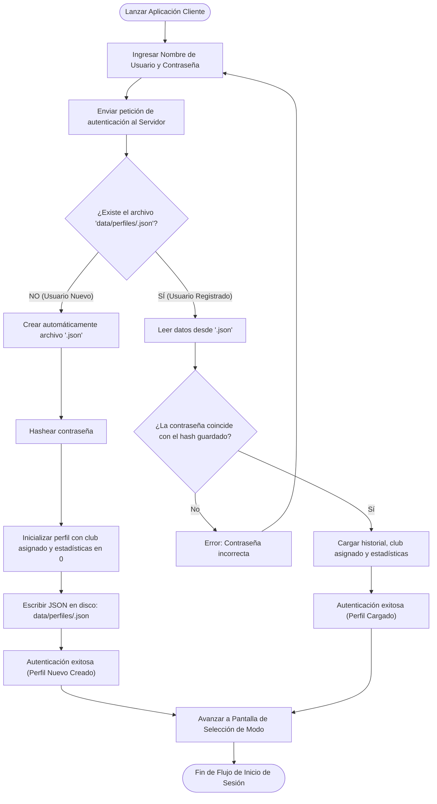
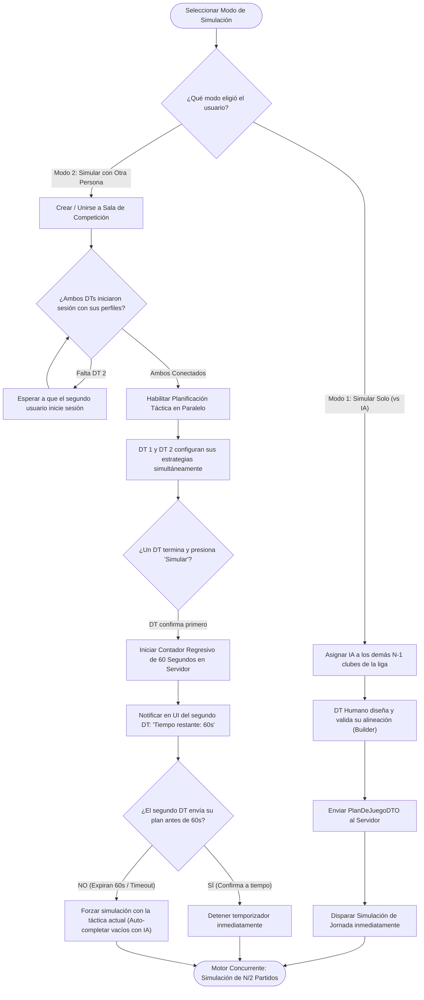
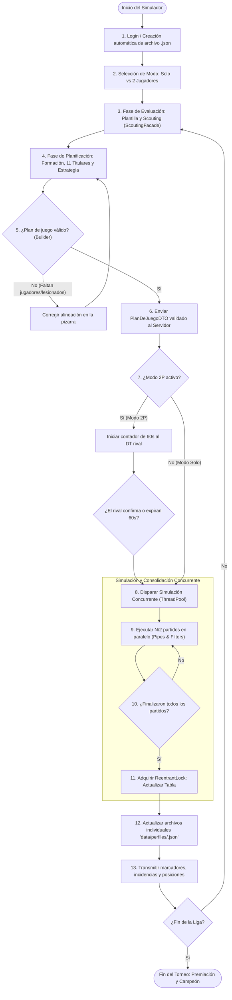
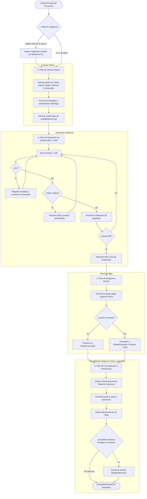
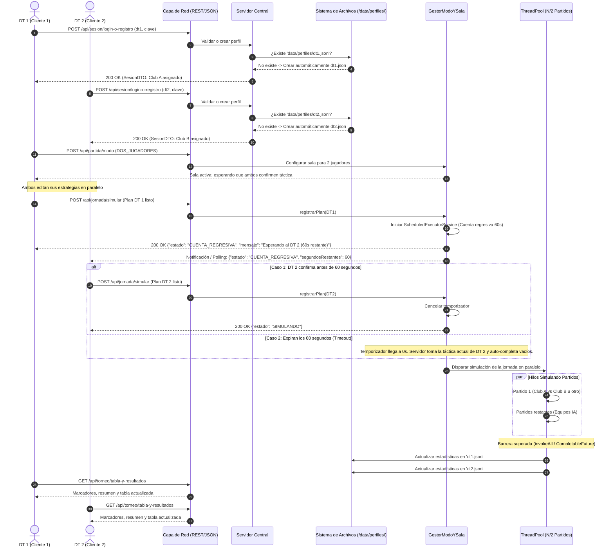
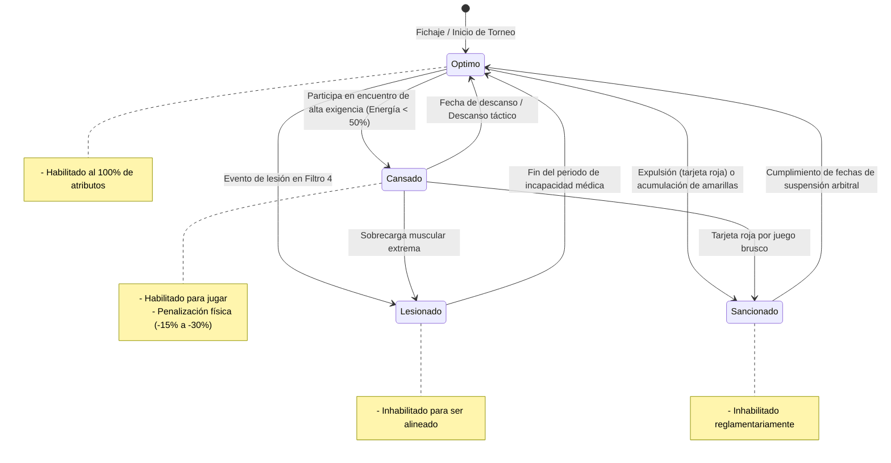
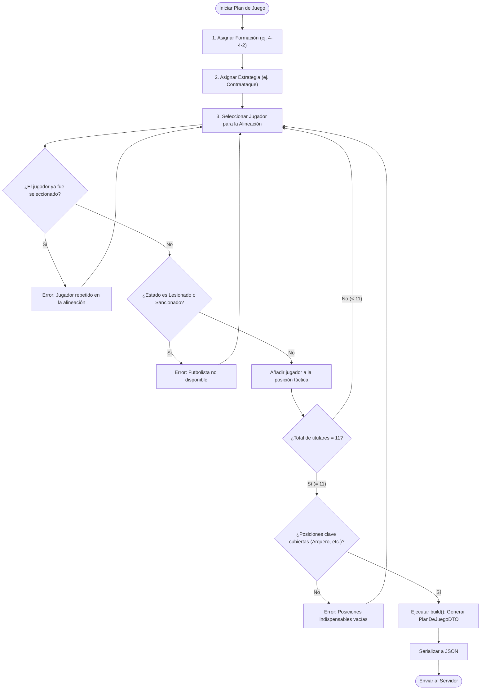

# Diagramas de Flujo del Sistema: "Soccer Manager"

Este documento describe de forma gráfica y detallada los flujos de control, datos, persistencia en archivos, concurrencia, sincronización de dos jugadores y transiciones de estado del sistema **Simulador Táctico "Soccer Manager"**.

---

## 1. Diagrama de Flujo: Inicio de Sesión y Generación Automática de Archivo de Perfil

Flujo ejecutado al abrir la aplicación donde cada mánager se autentica y el sistema gestiona su archivo de perfil individual (`data/perfiles/<usuario>.json`):

---

## 2. Diagrama de Flujo: Selección y Coordinación de Modos de Juego (Solo vs 2 Jugadores)

Muestra la lógica de bifurcación entre el modo en solitario y el modo multijugador coordinado:

---

## 3. Diagrama de Flujo Principal: Ciclo de Juego por Jornada (Game Loop Completo)

Integra la autenticación, los dos modos de juego y el guardado automático de archivos de perfil al concluir los partidos:

---

## 4. Diagrama de Flujo del Motor de Simulación: Tuberías y Filtros (*Pipes and Filters*)

Muestra las 5 etapas secuenciales que atraviesa cada partido individual y la actualización final de los archivos de perfil:

---

## 5. Diagrama de Secuencia: Modo 2 Jugadores (Autenticación, Espera y Simulación)

Muestra la interacción completa entre dos clientes humanos, el servidor, los archivos de perfil y el motor de simulación:

---

## 6. Diagrama de Transición de Estados: Ciclo de Vida del Futbolista (Patrón State)

---

## 7. Diagrama de Flujo del Patrón Builder: Validación de Alineación en Cliente

