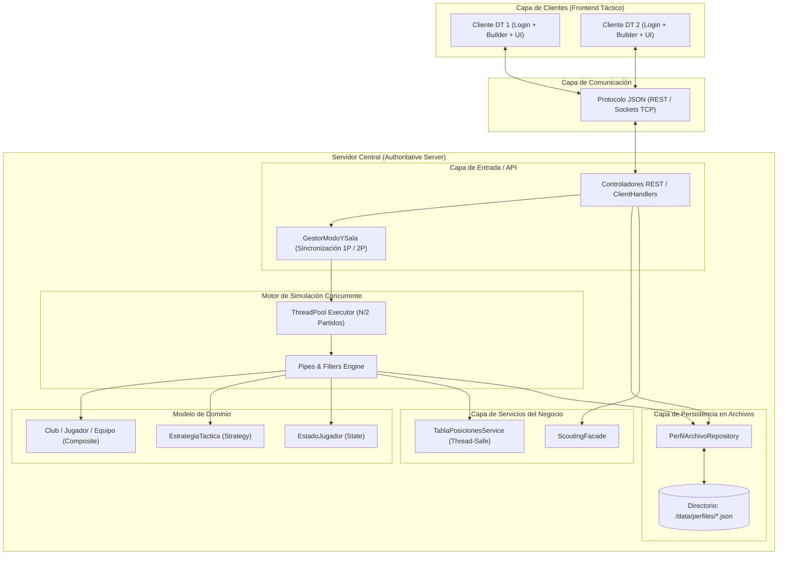
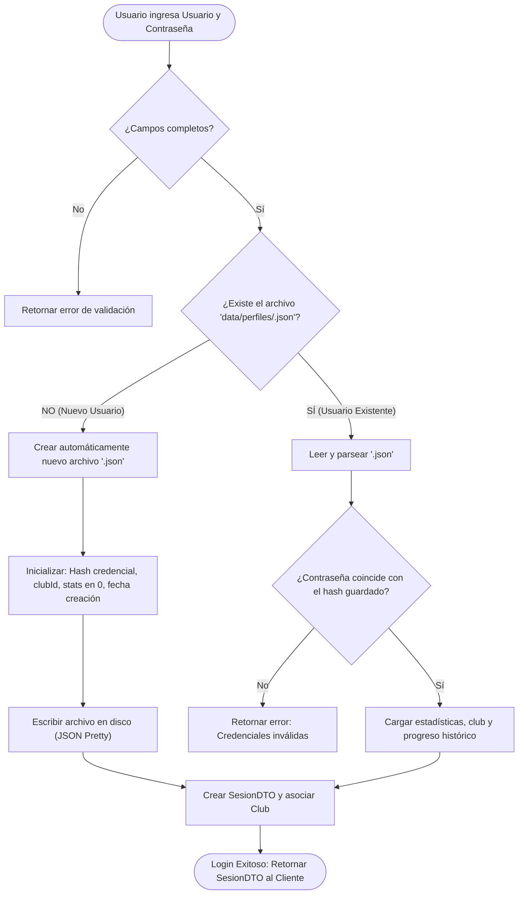
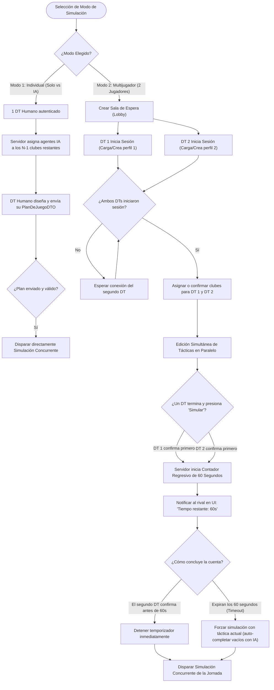
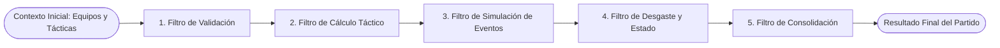

# Documento de Diseño de Arquitectura y Software: "Soccer Manager"

## 1. Visión General de la Arquitectura

El sistema **Simulador Táctico "Soccer Manager"** implementa una arquitectura híbrida y modular concebida para separar de forma estricta la presentación e interacción del usuario de la lógica de negocio, la persistencia en archivos y la computación matemática intensiva de las simulaciones deportivas.

El sistema soporta dos modalidades de operación:
1. **Modo Solitario (1 Jugador vs IA):** Un único Director Técnico inicia sesión con su perfil individual y compite contra clubes gestionados por agentes inteligentes.
2. **Modo Dúo / Multijugador (2 Jugadores Humanos en Red):** Dos Directores Técnicos inician sesión obligatoriamente con sus respectivos perfiles, gestionan sus clubes en la misma competición y deben coordinar el envío de sus tácticas antes de que el servidor simule la fecha.

La arquitectura se articula en dos niveles conceptuales:
* **Nivel Macro (Estilo Arquitectónico Cliente-Servidor):** Distribución física y lógica desacoplada donde el servidor actúa como autoridad central (*Authoritative Server*) y los clientes operan como terminales tácticos ligeros (*Thin/Smart Clients*).
* **Nivel Micro (Patrón Arquitectónico Pipes & Filters):** Motor de procesamiento secuencial por etapas dentro del servidor para la ejecución algorítmica de cada partido de la jornada.



---

## 2. Subsistema de Autenticación y Persistencia en Archivos

El sistema no requiere de un motor de bases de datos relacional externo; en su lugar, implementa un **almacenamiento desacoplado basado en archivos JSON individuales por perfil** gestionado por el servidor en la ruta `data/perfiles/`.



### 2.1. Estructura del Archivo de Perfil (`<usuario>.json`)
Cada usuario posee su propio archivo físico independiente:

```json
{
  "idPerfil": "usr-8a7f-4b12",
  "nombreUsuario": "manager_carlos",
  "passwordHash": "$2a$12$e8x...h4pW",
  "clubId": "club-01",
  "nombreClub": "Barcelona",
  "fechaCreacion": "2026-11-15T17:30:00",
  "ultimaConexion": "2026-11-15T18:00:00",
  "estadisticasHistoricas": {
    "partidosJugados": 14,
    "partidosGanados": 9,
    "partidosEmpatados": 3,
    "partidosPerdidos": 2,
    "golesAFavor": 28,
    "golesEnContra": 12,
    "titulosGanados": 1
  },
  "configuracion": {
    "notificaciones": true,
    "temaVisual": "oscuro"
  }
}
```

### 2.2. Componentes de Persistencia
* **`PerfilArchivoRepository`:** Clase que encapsula las operaciones de entrada/salida (I/O) en disco utilizando `Files.newBufferedReader` / `Files.newBufferedWriter` con la librería Jackson o Gson. Protege las operaciones de escritura mediante un `ReentrantReadWriteLock` por archivo para garantizar lecturas no bloqueantes y escrituras atómicas.
* **`PerfilService`:** Orquesta la lógica de negocio de perfiles (creación automática en primer inicio, verificación de contraseña, actualización de estadísticas tras simular la jornada).

---

## 3. Arquitectura de Modos de Simulación: Individual vs 2 Jugadores

El servidor implementa un componente denominado `GestorModoYSala` que coordina la sesión según el modo seleccionado:



### 3.1. Modo 1: Simular Solo (Individual)
* Un único mánager humano conectado.
* Los $N-1$ clubes restantes son controlados por el `IaTacticalService` del servidor.
* La jornada se simula a petición del único mánager una vez confirma su táctica.

### 3.2. Modo 2: Simular con Otra Persona (Dúo / 2 Jugadores en Red)
* **Doble Autenticación Requerida:** Requiere que dos clientes distintos inicien sesión con credenciales válidas; cada usuario opera con su propio archivo de perfil independiente (`data/perfiles/<usuario>.json`).
* **Clubes Asignados:** Cada mánager administra un club diferente dentro de la misma liga. Si ambos se enfrentan entre sí en esa fecha, sus planes tácticos se cruzarán directamente en el Filtro de Cálculo Táctico.
* **Edición Paralela de Tácticas:** Ambos mánagers tienen acceso simultáneo a sus plantillas, informes de scouting y pizarra táctica.
* **Mecanismo de Temporizador de 60 Segundos al Confirmar:**
  1. Cuando cualquiera de los dos jugadores completa su estrategia y presiona **"Simular Jornada"**, el servidor valida y registra su plan.
  2. En ese instante exacto, el servidor arranca un **contador regresivo de 60 segundos** gestionado por un `ScheduledExecutorService`.
  3. El cliente del segundo jugador recibe inmediatamente una actualización de estado: `{"estado": "CUENTA_REGRESIVA", "segundosRestantes": 60, "mensaje": "¡El rival ya confirmó su estrategia! Tienes 60 segundos para finalizar"}`.
  4. La interfaz del segundo jugador activa un cronómetro visible en rojo con cuenta regresiva.
* **Resolución de la Simulación:**
  * **Caso A (Confirmación a tiempo):** Si el segundo DT confirma su plan antes de los 60s, el servidor cancela el temporizador y lanza la simulación en paralelo inmediatamente.
  * **Caso B (Timeout / Expiración de 60s):** Si el temporizador llega a cero, el servidor congela la edición del segundo DT, toma su alineación tal y como la tenga configurada en ese instante, aplica un auto-completado de respaldo (*fallback*) con jugadores suplentes válidos si dejó puestos vacíos, y dispara la simulación sin retraso.

---

## 4. Arquitectura de Nivel Micro: Tuberías y Filtros (*Pipes and Filters*)

La simulación de cada partido no se realiza como un bloque de código monolítico, sino mediante una cadena de filtros desacoplados donde cada etapa recibe un contexto de partido (`ContextoPartido`), lo procesa o transforma, y lo transmite al siguiente filtro a través de una tubería (*Pipe*):



### Detalle de los Filtros:

1. **Filtro de Validación:**
   * **Entrada:** `ContextoPartido` con las alineaciones de ambos clubes.
   * **Proceso:** Inspecciona que cada club disponga de exactamente 11 futbolistas hábiles y que ninguno esté en estado `Lesionado` o `Sancionado`.
   * **Salida:** Contexto validado o excepción de partido.

2. **Filtro de Cálculo Táctico:**
   * **Entrada:** Contexto con formaciones y estrategias definidas.
   * **Proceso:**
     * Calcula los potenciales ofensivos y defensivos de cada línea del campo (Defensa, Mediocampo, Delantera) utilizando la estructura jerárquica del patrón *Composite*.
     * Evalúa el emparejamiento de estrategias tácticas (*Strategy*) y aplica modificadores de probabilidad (ventaja táctica y contrarrestos).
   * **Salida:** Coeficientes de probabilidad de gol, control y riesgo.

3. **Filtro de Simulación de Eventos (90 Minutos):**
   * **Entrada:** Coeficientes probabilísticos y atributos efectivos de los jugadores.
   * **Proceso:** Simula iterativamente los bloques temporales del partido (minutos 1 al 90). Genera goles, remates, asistencias, faltas, tarjetas y calificaciones individuales (1.0 a 10.0).
   * **Salida:** Registro cronológico de incidencias (`List<IncidenciaDTO>`) y marcador final.

4. **Filtro de Desgaste y Estado:**
   * **Entrada:** Minutos jugados, intensidad de la estrategia elegida y eventos del partido.
   * **Proceso:** Reduce la energía/resistencia de los futbolistas y calcula probabilidades de lesión por sobrecarga o impacto.
   * **Salida:** Actualización del estado fisiológico (`State`).

5. **Filtro de Consolidación y Persistencia:**
   * **Entrada:** Marcador final, estadísticas e incidencias.
   * **Proceso:** 
     * Actualiza la tabla de posiciones con `ReentrantLock`.
     * Si los clubes pertenecen a DTs humanos, invoca a `PerfilService` para actualizar sus archivos individuales de perfil en disco (`<usuario>.json`).
   * **Salida:** `ResultadoPartidoDTO` listo para ser transmitido a los clientes.

---

## 5. Patrones de Diseño de Software Implementados

```mermaid
classDiagram
    %% Patrón Repository / Persistencia
    class PerfilArchivoRepository {
        -String directorioPerfiles
        -ObjectMapper jsonMapper
        +guardar(perfil: PerfilUsuario) void
        +buscarPorNombre(nombre: String) Optional~PerfilUsuario~
        +existePerfil(nombre: String) boolean
    }
    class PerfilUsuario {
        -String idPerfil
        -String nombreUsuario
        -String passwordHash
        -String clubId
        -EstadisticasHistoricas stats
        +actualizarVictoria() void
        +actualizarEmpate() void
        +actualizarDerrota() void
    }
    PerfilArchivoRepository --> PerfilUsuario

    %% Patrón Builder
    class PlanDeJuegoBuilder {
        -String formacion
        -List~JugadorDTO~ titulares
        -String estrategia
        +setFormacion(f: String) PlanDeJuegoBuilder
        +agregarTitular(j: JugadorDTO) PlanDeJuegoBuilder
        +setEstrategia(e: String) PlanDeJuegoBuilder
        +validarReglas() boolean
        +build() PlanDeJuegoDTO
    }

    %% Patrón Facade
    class ScoutingFacade {
        -PartidoRepository partidoRepo
        -EstadisticaService statService
        +obtenerReporteRival(rivalId: String) ReporteRivalDTO
    }

    %% Patrón Composite
    class ComponenteTactico {
        <<interface>>
        +calcularPoderOfensivo() double
        +calcularPoderDefensivo() double
    }
    class Jugador {
        -String nombre
        -double tiro
        -double pase
        -double defensa
        -double fisico
        +calcularPoderOfensivo() double
        +calcularPoderDefensivo() double
    }
    class LineaTactica {
        -String tipoLinea
        -List~ComponenteTactico~ elementos
        +agregar(c: ComponenteTactico) void
        +calcularPoderOfensivo() double
        +calcularPoderDefensivo() double
    }
    class Equipo {
        -String nombreClub
        -List~LineaTactica~ lineas
        +calcularPoderOfensivo() double
        +calcularPoderDefensivo() double
    }
    ComponenteTactico <|.. Jugador
    ComponenteTactico <|.. LineaTactica
    ComponenteTactico <|.. Equipo
    LineaTactica o-- ComponenteTactico
    Equipo o-- LineaTactica

    %% Patrón Strategy
    class EstrategiaTactica {
        <<interface>>
        +aplicarModificadores(miEquipo: Equipo, rival: Equipo) ModificadorTáctico
        +calcularDesgaste() double
    }
    class PosesionStrategy {
        +aplicarModificadores(miEquipo: Equipo, rival: Equipo) ModificadorTáctico
        +calcularDesgaste() double
    }
    class ContraataqueStrategy {
        +aplicarModificadores(miEquipo: Equipo, rival: Equipo) ModificadorTáctico
        +calcularDesgaste() double
    }
    class PresionAltaStrategy {
        +aplicarModificadores(miEquipo: Equipo, rival: Equipo) ModificadorTáctico
        +calcularDesgaste() double
    }
    class BloqueBajoStrategy {
        +aplicarModificadores(miEquipo: Equipo, rival: Equipo) ModificadorTáctico
        +calcularDesgaste() double
    }
    EstrategiaTactica <|.. PosesionStrategy
    EstrategiaTactica <|.. ContraataqueStrategy
    EstrategiaTactica <|.. PresionAltaStrategy
    EstrategiaTactica <|.. BloqueBajoStrategy

    %% Patrón State
    class EstadoJugador {
        <<interface>>
        +puedeJugar() boolean
        +obtenerFactorRendimiento() double
        +avanzarJornada(jugador: Jugador) void
    }
    class EstadoOptimo {
        +puedeJugar() boolean
        +obtenerFactorRendimiento() double
        +avanzarJornada(jugador: Jugador) void
    }
    class EstadoCansado {
        +puedeJugar() boolean
        +obtenerFactorRendimiento() double
        +avanzarJornada(jugador: Jugador) void
    }
    class EstadoLesionado {
        -int semanasRestantes
        +puedeJugar() boolean
        +obtenerFactorRendimiento() double
        +avanzarJornada(jugador: Jugador) void
    }
    class EstadoSancionado {
        -int fechasRestantes
        +puedeJugar() boolean
        +obtenerFactorRendimiento() double
        +avanzarJornada(jugador: Jugador) void
    }
    EstadoJugador <|.. EstadoOptimo
    EstadoJugador <|.. EstadoCansado
    EstadoJugador <|.. EstadoLesionado
    EstadoJugador <|.. EstadoSancionado
    Jugador --> EstadoJugador
```



---

## 6. Programación Concurrente y Gestión de Hilos

### 6.1. Simulación Paralela de Partidos (`ExecutorService` + `Callable`)
* En una liga con $N$ clubes se disputan $N/2$ partidos independientes por jornada.
* Cada encuentro se encapsula en una tarea `Callable<ResultadoPartidoDTO>`.
* El servidor despacha las tareas a un grupo fijo de hilos:
  ```java
  ExecutorService executor = Executors.newFixedThreadPool(Runtime.getRuntime().availableProcessors());
  List<Future<ResultadoPartidoDTO>> resultados = executor.invokeAll(tareasPartidos);
  ```

### 6.2. Sincronización de Barrera de Jornada (`CompletableFuture` / `invokeAll`)
* El hilo orquestador principal espera a que todos los partidos de la fecha concluyan su ejecución antes de dar por cerrada la fecha y habilitar los resultados.

### 6.3. Sincronización de Sala y Temporizador de 60s (`ScheduledExecutorService` y `ReentrantLock`)
* Para coordinar la sincronización entre ambos jugadores sin bloqueos activos (*busy waiting*), el servidor implementa un temporizador concurrente con `ScheduledExecutorService`:
  ```java
  public class SalaEsperaMultiplayer {
      private final Lock lock = new ReentrantLock();
      private final ScheduledExecutorService scheduler = Executors.newSingleThreadScheduledExecutor();
      private ScheduledFuture<?> tareaTimeout;
      
      private int segundosRestantes = 60;
      private boolean dt1Listo = false;
      private boolean dt2Listo = false;
      private EstadoSala estado = EstadoSala.EN_PLANIFICACION;

      public void registrarPlan(int dtId, PlanDeJuegoDTO plan, Runnable onSimular) {
          lock.lock();
          try {
              if (dtId == 1) dt1Listo = true;
              if (dtId == 2) dt2Listo = true;

              // Caso 1: Ambos han confirmado -> Simulación inmediata
              if (dt1Listo && dt2Listo) {
                  cancelarTemporizador();
                  estado = EstadoSala.SIMULANDO;
                  onSimular.run();
                  return;
              }

              // Caso 2: Primer jugador confirma -> Iniciar cuenta regresiva de 60s
              if (estado != EstadoSala.CUENTA_REGRESIVA) {
                  estado = EstadoSala.CUENTA_REGRESIVA;
                  segundosRestantes = 60;
                  iniciarCountdown(onSimular);
              }
          } finally {
              lock.unlock();
          }
      }

      private void iniciarCountdown(Runnable onSimular) {
          tareaTimeout = scheduler.scheduleAtFixedRate(() -> {
              lock.lock();
              try {
                  segundosRestantes--;
                  if (segundosRestantes <= 0) {
                      cancelarTemporizador();
                      estado = EstadoSala.SIMULANDO;
                      // Timeout: forzar simulación con la táctica actual del rival
                      onSimular.run();
                  }
              } finally {
                  lock.unlock();
              }
          }, 1, 1, TimeUnit.SECONDS);
      }

      private void cancelarTemporizador() {
          if (tareaTimeout != null && !tareaTimeout.isDone()) {
              tareaTimeout.cancel(true);
          }
      }

      public SalaEstadoDTO getEstadoActual() {
          lock.lock();
          try {
              return new SalaEstadoDTO(estado, dt1Listo, dt2Listo, segundosRestantes);
          } finally {
              lock.unlock();
          }
      }
  }
  ```

### 6.4. Exclusión Mutua para Tablas y Persistencia (`ReentrantLock`)
* Se aplican bloqueos para garantizar que la escritura de resultados en `GestorTablaPosiciones` y en los archivos de perfil `.json` no sufra condiciones de carrera.

---

## 7. Protocolo de Comunicación y Catálogo de Endpoints

| Método | Endpoint / Acción | Parámetros / Cuerpo JSON | Respuesta Exitosa | Descripción |
| :--- | :--- | :--- | :--- | :--- |
| `POST` | `/api/sesion/login-o-registro` | `{"usuario": "...", "password": "..."}` | `200 OK` + `SesionDTO` | Autentica al DT. Si el perfil no existe, crea automáticamente su archivo `<usuario>.json`. |
| `POST` | `/api/partida/modo` | `{"modo": "SOLO" \| "DOS_JUGADORES"}` | `200 OK` + `{"modoActivo": "..."}` | Configura la modalidad de la partida actual. |
| `GET` | `/api/partida/sala-estado` | N/A | `200 OK` + `SalaEstadoDTO` | En modo 2P, informa si ambos jugadores están conectados y si ya enviaron sus tácticas. |
| `GET` | `/api/club/{id}/plantilla` | `id` (path param) | `200 OK` + `List<JugadorDTO>` | Retorna la nómina del club con atributos, fatiga y estado. |
| `GET` | `/api/scouting/{rivalId}` | `rivalId` (path param) | `200 OK` + `ReporteRivalDTO` | Invoca a la `ScoutingFacade` y retorna informe del rival. |
| `POST` | `/api/jornada/plan-juego` | `PlanDeJuegoDTO` | `200 OK` + `{"estado": "RECIBIDO"}` | Registra y valida la alineación táctica del usuario. |
| `POST` | `/api/jornada/simular` | `{"jornadaId": int}` | `202 ACCEPTED` / `409 CONFLICT` | Detona la simulación si se cumplen las condiciones del modo (en modo 2P rechaza si falta un DT). |
| `GET` | `/api/torneo/tabla-y-resultados` | N/A | `200 OK` + `ResumenJornadaDTO` | Devuelve marcadores finales, incidencias y tabla general actualizada. |

---

## 8. Estructura de Módulos y Código Fuente

```text
soccer-manager-system/
│
├── data/                                 # Directorio físico de persistencia
│   └── perfiles/                         # Archivos JSON individuales por mánager
│       ├── manager_carlos.json
│       └── manager_andres.json
│
├── common-dto/                           # Librería compartida (Contratos y DTOs)
│   └── src/main/java/com/soccermanager/common/dto/
│       ├── SesionDTO.java
│       ├── SalaEstadoDTO.java
│       ├── JugadorDTO.java
│       ├── PlanDeJuegoDTO.java
│       ├── ReporteRivalDTO.java
│       └── ResultadoPartidoDTO.java
│
├── server-app/                            # Aplicación Servidor (Backend, Motor y Persistencia)
│   └── src/main/java/com/soccermanager/server/
│       ├── api/                           # Controladores REST / TCP Server
│       │   ├── SesionController.java      # Login, creación automática de perfil
│       │   ├── ModoPartidaController.java # Control de 1P vs 2P
│       │   ├── ScoutingController.java
│       │   └── JornadaController.java
│       ├── persistence/                   # Persistencia en Archivos
│       │   ├── PerfilUsuario.java
│       │   └── PerfilArchivoRepository.java
│       ├── engine/                        # Motor de Simulación y Concurrencia
│       │   ├── SimuladorJornada.java
│       │   ├── SalaEsperaMultiplayer.java # Barrera de condición para 2 jugadores
│       │   └── pipeline/                  # Pipes & Filters
│       │       ├── PipelinePartidos.java
│       │       ├── FiltroValidacion.java
│       │       ├── FiltroCalculoTactico.java
│       │       ├── FiltroSimulacionEventos.java
│       │       ├── FiltroDesgaste.java
│       │       └── FiltroConsolidacion.java
│       ├── domain/
│       │   ├── model/                     # Composite (Club, LineaTactica, Jugador)
│       │   ├── strategy/                  # Strategy (Posesion, Contraataque, etc.)
│       │   └── state/                     # State (Optimo, Cansado, Lesionado, Sancionado)
│       └── services/
│           ├── PerfilService.java
│           ├── ScoutingFacade.java
│           └── TablaPosicionesService.java (ReentrantLock)
│
└── client-app/                            # Aplicación Cliente (Frontend del Mánager)
    └── src/main/java/com/soccermanager/client/
        ├── network/                       # Cliente HTTP / Cliente TCP
        │   └── MotorConexion.java
        ├── builders/                      # Patrón Builder
        │   └── PlanDeJuegoBuilder.java
        └── ui/                            # Vistas Gráficas (MVP)
            ├── VistaLoginRegistro.java    # Entrada usuario/clave, feedback de archivo creado
            ├── VistaSelectorModo.java     # Solo vs 2 Jugadores
            ├── VistaMiPlantilla.java
            ├── VistaCentroScouting.java
            ├── VistaPizarraTactica.java
            └── VistaPanelResultados.java
```

---

## 9. Vistas Principales de la Interfaz de Usuario (MVP Ampliado)

1. **Vista de Login y Creación de Perfil:** Formulario de inicio donde se introduce nombre de usuario y contraseña. Si es nuevo, notifica: *"Nuevo perfil detectado: Archivo perfiles/<usuario>.json generado exitosamente"*.
2. **Vista Selector de Modo:** Permite seleccionar entre *Simular Solo (vs IA)* o *Simular con Otra Persona (2 Jugadores)*. En modo 2 jugadores, muestra el estado de conexión del segundo mánager y la sala de espera.
3. **Vista Mi Plantilla:** Tabla interactiva con métricas, barras de fatiga y estado físico/disciplinario.
4. **Vista Centro de Scouting:** Análisis comparativo frente a frente con el rival (líneas de campo y jugador estrella).
5. **Vista Pizarra Táctica:** Selección de formación, alineación de 11 titulares y estrategia. En modo 2 jugadores incluye un indicador de estado: *"Esperando que el segundo DT confirme su alineación"*.
6. **Vista Panel de Resultados y Clasificación:** Resumen de marcadores de la fecha, incidencias, tabla de posiciones y actualización visual del perfil del usuario (nuevo balance de victorias/empates/derrotas).
