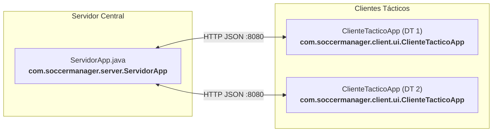
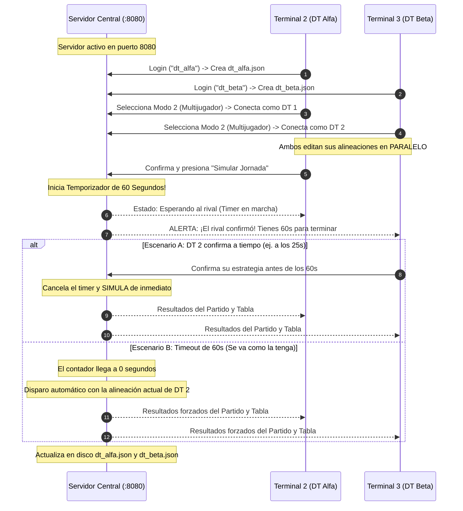

# Guía Completa de Pruebas y Ejecución: Simulador Táctico "Soccer Manager"

Esta guía detalla paso a paso los requisitos, librerías, comandos de compilación y procedimientos de prueba para ejecutar el sistema tanto en **Modo Individual (Jugar Solo vs IA)** como en **Modo Multijugador (2 Jugadores en Red con Temporizador Competitivo de 60 Segundos)**.

---

## 1. Requisitos del Sistema y Librerías

El proyecto está diseñado bajo una arquitectura limpia y modular en Java 17 LTS, minimizando dependencias externas y maximizando la portabilidad.

### 1.1. Software Base Necesario
* **Java Development Kit (JDK):** Versión **17 LTS** o superior instalada y configurada en la variable de entorno `PATH` (`java -version`).
* **Apache Maven:** Versión **3.8+** recomendada para la gestión del ciclo de vida y empaquetado multi-módulo (`mvn -version`).
* **Sistema Operativo:** Compatible con Windows 10/11, Linux o macOS.
* **Terminales:** Para las pruebas multijugador se recomienda abrir de 2 a 3 terminales (PowerShell, CMD o Bash) en paralelo.

### 1.2. Librerías y Dependencias del Proyecto
Todas las dependencias están gestionadas en el archivo raíz [pom.xml](file:///c:/Users/davin/Desktop/estudio/semestre%2010/arq.%20clie.%20ser/proyecto_final/soccer-manager-system/pom.xml):

| Librería / Módulo | Versión | Uso en el Sistema |
| :--- | :---: | :--- |
| **Jackson Databind** (`jackson-databind`) | `2.15.2` | Serialización y deserialización de contratos DTO y archivos físicos `.json` de perfiles de usuario. |
| **Jackson Java 8 Time** (`jackson-datatype-jsr310`) | `2.15.2` | Soporte para fechas y marcas de tiempo (`LocalDateTime`, `Instant`) en los perfiles. |
| **JUnit Jupiter API & Engine** (`junit-jupiter`) | `5.9.3` | Framework de pruebas unitarias, de concurrencia e integración. |
| **Java Standard HTTP Server** (`com.sun.net.httpserver`) | JDK 17 | Servidor HTTP embebido y multihilo en el Authoritative Server (sin dependencias pesadas como Tomcat o Spring). |
| **Java Standard HTTP Client** (`java.net.http.HttpClient`) | JDK 17 | Motor de conexión cliente no bloqueante para comunicación REST/JSON. |

---

## 2. Mapa de Archivos a Ejecutar

El sistema cuenta con dos puntos de entrada principales (`main`):



1. **Servidor Central (Authoritative Server):**
   * **Archivo fuente:** [ServidorApp.java](file:///c:/Users/davin/Desktop/estudio/semestre%2010/arq.%20clie.%20ser/proyecto_final/soccer-manager-system/server-app/src/main/java/com/soccermanager/server/ServidorApp.java)
   * **Clase completamente calificada:** `com.soccermanager.server.ServidorApp`
   * **Responsabilidad:** Inicializa la base de datos de perfiles en archivos `data/perfiles/`, expone los 8 endpoints REST en el puerto `8080`, coordina la sala de espera, administra el temporizador de 60 segundos y computa la simulación de partidos mediante *Pipes & Filters*.

2. **Cliente Táctico Interactivo (Tactical Client):**
   * **Archivo fuente:** [ClienteTacticoApp.java](file:///c:/Users/davin/Desktop/estudio/semestre%2010/arq.%20clie.%20ser/proyecto_final/soccer-manager-system/client-app/src/main/java/com/soccermanager/client/ui/ClienteTacticoApp.java)
   * **Clase completamente calificada:** `com.soccermanager.client.ui.ClienteTacticoApp`
   * **Responsabilidad:** Interfaz de usuario por consola con validaciones en tiempo real mediante `PlanDeJuegoBuilder`, visualización de plantilla, scouting con `ScoutingFacade`, pizarra táctica interactiva, widget de cuenta regresiva de 60 segundos y panel de resultados.

---

## 3. Compilación y Ejecución de la Suite de Pruebas

Abra una terminal en la raíz del proyecto (`soccer-manager-system/`):

```powershell
cd "c:\Users\davin\Desktop\estudio\semestre 10\arq. clie. ser\proyecto_final\soccer-manager-system"
```

### 3.1. Compilar todo el sistema
```bash
mvn clean compile
```

### 3.2. Ejecutar toda la batería de pruebas automáticas (QA)
Para correr todas las pruebas unitarias y de concurrencia de los 8 bloques:
```bash
mvn test
```

Esta orden ejecutará automáticamente:
* `PerfilServiceTest`: Pruebas de persistencia JSON y hashing SHA-256 + Salt.
* `DominioPatronesTest`: Pruebas de los patrones Composite, Strategy y State.
* `SimuladorJornadaTest`: Pruebas del pipeline de 5 filtros y concurrencia.
* `LobbyYScoutingTest`: Pruebas del temporizador y Facade.
* `ClienteServidorApiTest`: Pruebas de integración de la API REST.
* `PlanDeJuegoBuilderTest`: Pruebas de validación táctica local del Builder.
* `SimuladorCompletoIntegrationTest`: Pruebas de estrés con 10 partidos simultáneos e invariantes deportivos.

---

## 4. Instrucciones para la Prueba 1: Modo Individual (Jugar Solo vs IA)

En este modo, un único mánager se autentica (generando su archivo de perfil), selecciona a su club y compite contra la Inteligencia Artificial. La simulación ocurre de forma inmediata al enviar la táctica.

### Paso 1: Iniciar el Servidor Central
Abra la **Terminal 1** y ejecute:

```powershell
cd "c:\Users\davin\Desktop\estudio\semestre 10\arq. clie. ser\proyecto_final\soccer-manager-system"
mvn exec:java -pl server-app -Dexec.mainClass="com.soccermanager.server.ServidorApp"
```
*(Alternativa usando `java` directo tras compilar: `java -cp "server-app/target/classes;common-dto/target/classes;..." com.soccermanager.server.ServidorApp`)*

Verá en consola:
```text
============================================================
      SERVIDOR 'SOCCER MANAGER' INICIADO CORRECTAMENTE       
============================================================
>> Modo: Authoritative Server (Headless)
>> Escuchando peticiones en: http://localhost:8080
>> Directorio de perfiles: data/perfiles/
...
```

### Paso 2: Iniciar el Cliente Táctico
Abra la **Terminal 2** y ejecute:

```powershell
cd "c:\Users\davin\Desktop\estudio\semestre 10\arq. clie. ser\proyecto_final\soccer-manager-system"
mvn exec:java -pl client-app -Dexec.mainClass="com.soccermanager.client.ui.ClienteTacticoApp"
```

### Paso 3: Registro o Inicio de Sesión
1. Ingrese su nombre de mánager (ejemplo: `guardiola_solo`).
2. Ingrese su contraseña secreta (ejemplo: `clave123`).
3. El sistema verificará si el usuario existe. Si es nuevo, el servidor imprimirá:
   `[PERFIL NUEVO] Se ha creado automáticamente el archivo de perfil en disco.`
4. Seleccione su equipo (ejemplo: `1` para Barcelona).

### Paso 4: Comprobación del Archivo de Perfil en Disco
Sin cerrar el juego, verifique en su explorador de archivos o terminal que se ha creado físicamente el archivo individual:
`soccer-manager-system/data/perfiles/guardiola_solo.json`

Al abrirlo, verá su estructura con contraseña hasheada y estadísticas iniciales:
```json
{
  "nombreUsuario" : "guardiola_solo",
  "hashPassword" : "...",
  "salt" : "...",
  "idClubAsignado" : "club-1",
  "nombreClub" : "Barcelona",
  "partidosJugados" : 0,
  "partidosGanados" : 0,
  "partidosEmpatados" : 0,
  "partidosPerdidos" : 0,
  "puntosTotales" : 0
}
```

### Paso 5: Selección de Modo y Flujo de Juego
1. En el menú principal, seleccione:
   `1. Modo Individual (Solo vs IA)`
2. Navegue por las opciones:
   * **Opción 1 (Ver Mi Plantilla):** Revise la lista de jugadores, sus posiciones, medias y su estado (*State*: Óptimo, Cansado, Lesionado).
   * **Opción 2 (Centro de Scouting):** Analice al rival de la fecha con el reporte consolidado provisto por `ScoutingFacade`.
   * **Opción 3 (Configurar Pizarra Táctica):** Ingrese la formación (ej: `4-4-2`), la estrategia táctica (ej: `1. Posesion`) y confirme los 11 titulares. Si prefiere rapidez, presione `S` para usar la alineación recomendada. El `PlanDeJuegoBuilder` validará las reglas tácticas.
   * **Opción 4 (Simular Jornada):** Presione Enter para simular.
3. Al estar en **Modo Solo**, el servidor procesará el partido de forma inmediata a través de la tubería de filtros (*Pipes & Filters*).
4. El cliente mostrará automáticamente:
   * Marcador final del partido.
   * Minuto a minuto de incidencias (goles, tarjetas, lesiones).
   * Tabla general de posiciones actualizada.
5. Vuelva a abrir `data/perfiles/guardiola_solo.json` y observe cómo sus estadísticas se actualizaron en disco (partidos jugados: 1, puntos sumados, etc.).

---

## 5. Instrucciones para la Prueba 2: Modo Multijugador (2 Jugadores con Temporizador de 60s)

Esta prueba demuestra la interacción cliente-servidor en red, la edición concurrente de tácticas y el funcionamiento del **temporizador competitivo de 60 segundos**.

### Arquitectura de la Prueba:
* **Terminal 1:** Servidor Central (`ServidorApp`).
* **Terminal 2:** Cliente 1 (DT Alfa, controlando por ejemplo a Millonarios FC).
* **Terminal 3:** Cliente 2 (DT Beta, controlando por ejemplo a América de Cali).



### Paso a Paso para la Ejecución Multijugador:

#### 1. Iniciar el Servidor (Terminal 1)
```powershell
mvn exec:java -pl server-app -Dexec.mainClass="com.soccermanager.server.ServidorApp"
```

#### 2. Iniciar el Jugador 1 (Terminal 2)
```powershell
mvn exec:java -pl client-app -Dexec.mainClass="com.soccermanager.client.ui.ClienteTacticoApp"
```
* **Usuario:** `dt_alfa` | **Clave:** `1234`
* **Equipo:** Seleccionar `Millonarios FC` (Opción 2).
* **Modo de Juego:** Seleccionar `2. Modo 2 Jugadores (En Red)`.
* La pantalla indicará: `[SALA DE ESPERA] Esperando la conexión del segundo DT...`

#### 3. Iniciar el Jugador 2 (Terminal 3)
Abra una tercera terminal y ejecute:
```powershell
mvn exec:java -pl client-app -Dexec.mainClass="com.soccermanager.client.ui.ClienteTacticoApp"
```
* **Usuario:** `dt_beta` | **Clave:** `5678`
* **Equipo:** Seleccionar `América de Cali` (Opción 3).
* **Modo de Juego:** Seleccionar `2. Modo 2 Jugadores (En Red)`.
* En ambas terminales se notificará que los 2 DTs están listos y pasarán a la etapa de planificación simultánea.

#### 4. Edición de Estrategias en Paralelo
* Ambos mánagers pueden navegar libremente por sus plantillas, centros de scouting y configurar su pizarra táctica al mismo tiempo.
* Cada uno puede seleccionar formaciones y estrategias distintas (por ejemplo, DT Alfa selecciona *4-3-3 Presión Alta* y DT Beta selecciona *5-3-2 Contraataque*).

#### 5. Prueba del Temporizador de 60 Segundos
1. En la **Terminal 2 (DT Alfa)**, diríjase a la opción `4. Simular Jornada` y presione Enter para confirmar.
2. Observe lo que sucede de inmediato:
   * **En el Servidor:** Se imprimirá en el log:  
     `>> DT 'dt_alfa' ha confirmado su estrategia. Se activa la cuenta regresiva de 60 segundos para el rival!`
   * **En la Terminal 3 (DT Beta):** En la consola aparecerá el aviso destacado:  
     `⏳ [TEMPORIZADOR ACTIVO]: Tienes 60 segundos para definir tu estrategia!`  
     El contador irá descendiendo segundo a segundo: `59s`, `58s`, `57s`...

#### 6. Probar los Dos Escenarios de Finalización:

* **Escenario A (Confirmación oportuna):**
  * Antes de que el reloj llegue a 0s, en la **Terminal 3 (DT Beta)** presione la opción `4. Simular Jornada`.
  * El servidor detecta la confirmación del segundo mánager, cancela el temporizador de inmediato y simula el encuentro al instante sin esperar a que transcurran los 60 segundos completos.
  * Ambas terminales reciben la notificación con el pitido final, el resumen del partido y la tabla general de posiciones.

* **Escenario B (Timeout / "Se va como la tenga"):**
  * Repita la prueba o espere los 60 segundos sin presionar nada en la Terminal 3.
  * Cuando el cronómetro del servidor alcance los `0 segundos`, el `TemporizadorJornada` forzará automáticamente la captura de la táctica de DT Beta tal y como la tenga configurada (si no completó los 11 titulares, el filtro de validación del servidor auto-completará con juveniles de la cantera) y disparará la simulación.
  * El partido se resuelve con éxito y los dos mánagers reciben los marcadores e incidencias de la fecha.

#### 7. Comprobación de Persistencia Concurrente
Al terminar el partido, revise los dos archivos generados en `data/perfiles/`:
* [dt_alfa.json](file:///c:/Users/davin/Desktop/estudio/semestre%2010/arq.%20clie.%20ser/proyecto_final/soccer-manager-system/data/perfiles/dt_alfa.json)
* [dt_beta.json](file:///c:/Users/davin/Desktop/estudio/semestre%2010/arq.%20clie.%20ser/proyecto_final/soccer-manager-system/data/perfiles/dt_beta.json)

Ambos archivos habrán sido actualizados concurrentemente con los puntos, goles a favor y goles en contra correspondientes al resultado del clásico.

---

## 6. Scripts de Ejecución Rápida

Para facilitar las pruebas sin escribir comandos largos en cada terminal, puede utilizar los siguientes comandos directos en PowerShell:

### Iniciar Servidor (Terminal 1)
```powershell
powershell -Command "cd 'c:\Users\davin\Desktop\estudio\semestre 10\arq. clie. ser\proyecto_final\soccer-manager-system'; mvn exec:java -pl server-app -Dexec.mainClass='com.soccermanager.server.ServidorApp'"
```

### Iniciar Cliente 1 (Terminal 2)
```powershell
powershell -Command "cd 'c:\Users\davin\Desktop\estudio\semestre 10\arq. clie. ser\proyecto_final\soccer-manager-system'; mvn exec:java -pl client-app -Dexec.mainClass='com.soccermanager.client.ui.ClienteTacticoApp'"
```

### Iniciar Cliente 2 (Terminal 3)
```powershell
powershell -Command "cd 'c:\Users\davin\Desktop\estudio\semestre 10\arq. clie. ser\proyecto_final\soccer-manager-system'; mvn exec:java -pl client-app -Dexec.mainClass='com.soccermanager.client.ui.ClienteTacticoApp'"
```

---

## 7. Preguntas Frecuentes y Solución de Problemas (Troubleshooting)

1. **¿Qué ocurre si el puerto 8080 ya está ocupado?**
   * Puede pasar un puerto alternativo como argumento al servidor:  
     `mvn exec:java -pl server-app -Dexec.mainClass="com.soccermanager.server.ServidorApp" -Dexec.args="8090"`
   * En el cliente, el `MotorConexion` se conectará por defecto al puerto indicado o puede ajustarse en el código de inicialización.

2. **¿Dónde se guardan los perfiles de usuario?**
   * Se almacenan localmente en la carpeta `soccer-manager-system/data/perfiles/` en formato `.json`. Cada archivo lleva el nombre del mánager en minúsculas (ej: `carlos.json`).

3. **¿Cómo resetear todos los datos de prueba?**
   * Para reiniciar la liga desde cero, simplemente borre los archivos contenidos en `soccer-manager-system/data/perfiles/`. El servidor los volverá a crear automáticamente conforme los usuarios inicien sesión.

4. **¿Por qué los hilos del servidor se apagan limpiamente al presionar Ctrl+C?**
   * Porque se implementó un `ShutdownHook` en `ServidorApp.java` que invoca `servidor.detener()`, el cual a su vez detiene el `ScheduledExecutorService` del temporizador y el `ThreadPool` de simulación.
